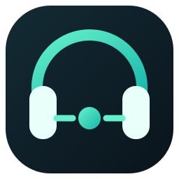
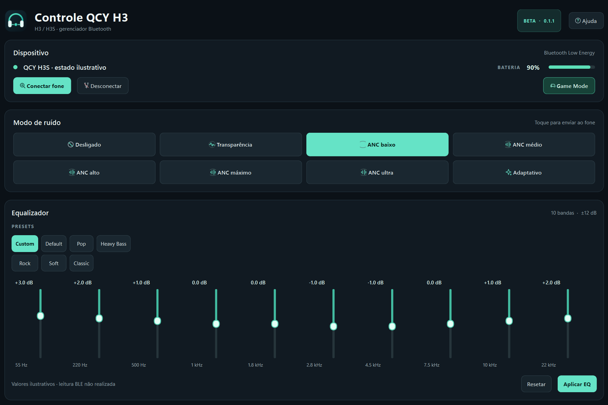
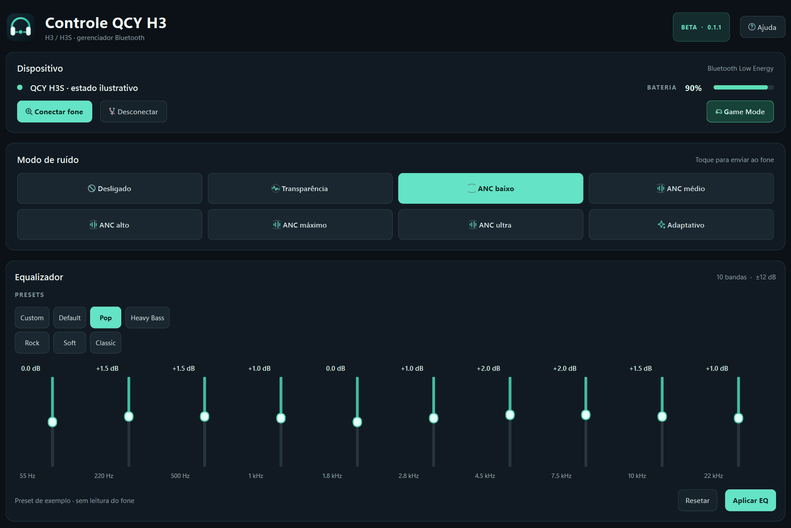
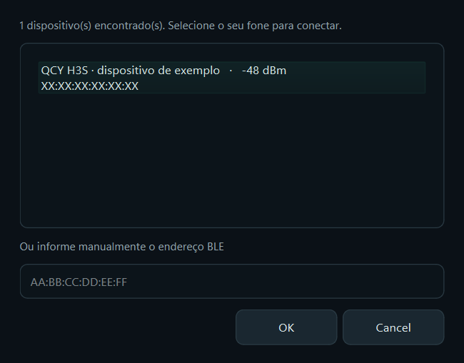

<div align="center">
  
  <h1>Controle QCY H3</h1>
  <p>Gerenciador Bluetooth pessoal para QCY H3 e QCY H3S</p>
  <p><strong>Beta de testes · v0.1.1-beta · Windows 10/11</strong></p>
  <p><a href="https://github.com/Deivisan/qcy-h3s-windows/releases/tag/v0.1.1-beta">Baixar o aplicativo</a> · <a href="docs/COMPATIBILIDADE.md">Compatibilidade</a> · <a href="docs/FAQ.md">Ajuda</a></p>
</div>

---

## Visão geral

Aplicativo desktop independente para ajustar funções do fone pelo Bluetooth
Low Energy (BLE), sem depender do aplicativo oficial da QCY. O projeto é feito
para **QCY H3 padrão e QCY H3S**. O H3S foi testado em hardware; no H3 padrão,
a compatibilidade depende da revisão e do firmware e ainda precisa de relatos
de outros usuários.

O download é um executável portátil: não precisa instalar Python ou pacotes.

## Capturas de tela

As imagens abaixo mostram a interface e seus controles. **Os valores e o estado
de conexão nas capturas são ilustrativos**; eles não representam uma conexão
ativa nem a leitura de um fone durante a captura.

### Painel de controle

Conexão, nível de bateria, modos de ruído, Game Mode e equalizador na mesma tela.



### Equalizador de 10 bandas

Presets rápidos ou ajuste individual das bandas, com feedback de leitura após
aplicar.



### Localizar e conectar o fone

O endereço na imagem é fictício e foi mascarado para proteger identificadores
Bluetooth reais.



## Baixar e começar

1. Acesse a [release v0.1.1-beta](https://github.com/Deivisan/qcy-h3s-windows/releases/tag/v0.1.1-beta).
2. Baixe `Controle_QCY_H3_0.1.1-beta.exe`.
3. Ligue o fone e ative o Bluetooth do computador.
4. Abra o executável e selecione **Conectar fone**.
5. Escolha o QCY H3/H3S na lista. Se não aparecer, consulte [solução de problemas](docs/FAQ.md).

**Requisitos:** Windows 10 ou 11 e adaptador Bluetooth com suporte BLE. O
aplicativo usa a conexão BLE de controle do fone; pareamento de áudio no Windows
e conexão BLE de controle são coisas relacionadas, mas não idênticas.

## O que dá para controlar

| Recurso | O que faz |
|---|---|
| Modos de ruído | ANC desligado, transparência, níveis de ANC e modo adaptativo disponíveis no firmware testado |
| Equalizador | 10 bandas, presets e ajuste de −12 a +12 dB; após aplicar, o app lê o EQ de volta |
| Game Mode | Alterna o modo de baixa latência; é separado dos modos de ruído |
| Bateria | Mostra o nível reportado pelo fone e atualiza periodicamente |
| Atalhos | `Ctrl+K` conectar, `Ctrl+G` Game Mode, `Ctrl+Enter` aplicar EQ, `Ctrl+0` zerar EQ, `F1` ajuda |

Controles que não foram confirmados no H3S — como áudio espacial, redução de
vento, detecção de uso, tom de toque e modos Música/Filme/Jogo — foram deixados
fora da interface para não sugerir que funcionam. O Game Mode superior é um
comando diferente e continua disponível.

## Compatibilidade e limites da beta

- O programa é direcionado ao **QCY H3 e ao QCY H3S**.
- O QCY H3S foi conectado e testado nesta implementação, incluindo ANC, bateria,
  Game Mode e alteração/read-back do EQ.
- Não temos ainda uma unidade QCY H3 padrão para validar cada firmware e revisão.
  Se testar nesse modelo, informe o resultado usando o [relatório de teste](docs/TESTES-BETA.md).
- O protocolo e o comportamento BLE podem variar entre revisões, firmware,
  adaptadores Bluetooth e drivers do Windows.
- A confirmação falada pelo fone é gerada pelo firmware; o aplicativo não pode
  garantir que ela será reproduzida em toda troca de modo.
- Esta é uma beta de testes, não uma versão certificada nem um aplicativo oficial.

Consulte a [matriz de compatibilidade e validação](docs/COMPATIBILIDADE.md) para
separar o que foi observado em hardware do que ainda precisa ser testado.

## Solução rápida de problemas

1. **O fone não aparece:** confirme que está ligado e próximo, feche temporariamente
   o app oficial/outros controladores BLE e tente novamente.
2. **Aparece, mas falha ao conectar:** outro cliente pode estar usando o canal de
   controle. Desconecte-o e tente novamente; veja [FAQ](docs/FAQ.md).
3. **Um clique não parece mudar o fone:** aguarde a leitura/status do app. Um ACK
   de protocolo nem sempre prova que o firmware aplicou o estado.
4. **O EQ não mantém os valores:** o app lê o EQ depois do envio e mostra os
   valores retornados pelo fone; firmware pode limitar ou rejeitar alterações.

Para relatar um problema, inclua modelo, versão do Windows, adaptador Bluetooth,
passos para reproduzir e o resultado esperado/obtido. **Remova endereço MAC,
serial e outros identificadores pessoais** antes de anexar logs ou capturas.
[Abrir um relato](https://github.com/Deivisan/qcy-h3s-windows/issues/new).

## Privacidade e segurança

- O aplicativo conversa localmente com o fone por BLE; não implementa conta,
  telemetria ou envio de dados para um servidor.
- O endereço BLE do último fone conectado é salvo apenas nas configurações locais
  do usuário do Windows para facilitar a reconexão; não há um MAC de unidade
  pessoal embutido na instalação nova.
- O Windows pode exibir o aviso do SmartScreen porque o executável beta não é
  assinado digitalmente. Baixe somente da release deste repositório.
- Não há atualização de firmware/OTA neste aplicativo.
- Comandos de reset, pareamento, LDAC e outras funções potencialmente destrutivas
  não fazem parte da interface gráfica.

## Para quem vai desenvolver

```powershell
git clone https://github.com/Deivisan/qcy-h3s-windows.git
cd qcy-h3s-windows
python -m venv .venv
.venv\Scripts\Activate.ps1
python -m pip install -r requirements.txt pyinstaller
python app.py
```

Executar testes e gerar o executável:

```powershell
python -m unittest discover -s tests -v
python tools/build_icon.py
pyinstaller --noconfirm QCY_H3_Controller.spec
```

O resultado do build fica em `dist/QCY_H3_Controller.exe`. O protocolo RCSP,
leituras observadas, notas de Bluetooth no Windows e botões físicos estão na
[documentação técnica](docs/README.md).

## Licença e marca

Código sob licença MIT. QCY, H3 e H3S são marcas de seus respectivos titulares.
Este é um projeto pessoal e independente, sem afiliação ou endosso oficial da
QCY.
